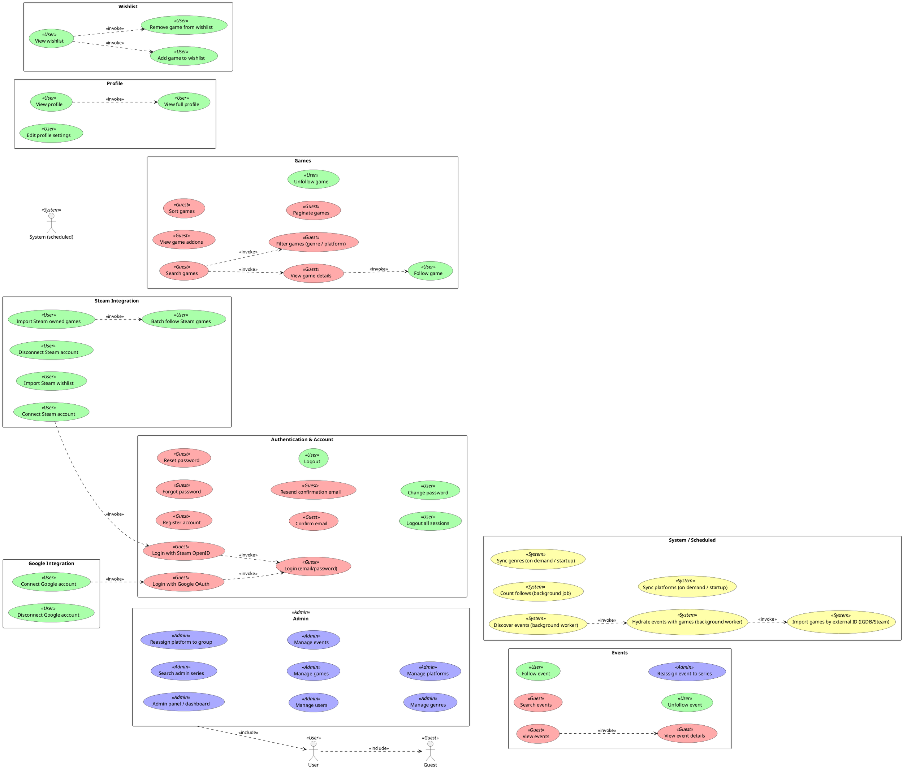

# Use Case Diagram — Game News Hub

Format: PlantUML.  
Stereotype `<<invoke>>` means that one use case triggers another (e.g. view game details → follow game).  
Actors: **Guest**, **User**, **Admin**, **System** (scheduled/time-triggered).

---

## PlantUML source

---

## Actor privilege matrix

| Actor | Can do |
|-------|--------|
| **Guest** | Browse games & events, search, filter (genre/platform), sort, paginate, view game/event details and addons, register, login (email / Google / Steam), password reset flow |
| **User** | Everything Guest can + follow/unfollow games & events, wishlist add/remove, profile view & settings edit, connect/disconnect Steam & Google accounts, import Steam wishlist & owned games, batch-follow Steam games, logout / logout-all, change password |
| **Admin** | Everything User can + admin panel, series search, reassign platform to group, reassign event to series, manage users / games / events / genres / platforms |
| **System (scheduled)** | Discover events, hydrate events with games, count follows, sync genres/platforms, import games by external ID |

---

## Package breakdown

### Authentication & Account
- Register account (Guest)
- Login email/password (Guest)
- Login with Google OAuth (Guest) → `<<invoke>>` Login
- Login with Steam OpenID (Guest) → `<<invoke>>` Login
- Forgot / Reset password (Guest)
- Confirm / Resend confirmation email (Guest)
- Logout / Logout all sessions (User)
- Change password (User)

### Games
- Search games (Guest) → `<<invoke>>` View game details
- View game details (Guest) → `<<invoke>>` Follow game
- View game addons (Guest)
- Filter games by genre/platform (Guest)
- Sort games (Guest)
- Paginate games (Guest)
- Follow / Unfollow game (User)

### Events
- View events (Guest) → `<<invoke>>` View event details
- View event details (Guest)
- Search events (Guest)
- Follow / Unfollow event (User)
- Reassign event to series (Admin)

### Profile
- View profile (User) → `<<invoke>>` View full profile
- Edit profile settings (User)

### Wishlist
- View wishlist (User) → `<<invoke>>` Add / Remove game from wishlist
- Add game to wishlist (User)
- Remove game from wishlist (User)

### Steam Integration
- Connect / Disconnect Steam account (User) → `<<invoke>>` Login with Steam
- Import Steam wishlist (User)
- Import Steam owned games (User) → `<<invoke>>` Batch follow Steam games
- Batch follow Steam games (User)

### Google Integration
- Connect / Disconnect Google account (User) → `<<invoke>>` Login with Google

### Admin
- Admin panel / dashboard (Admin)
- Search admin series (Admin)
- Reassign platform to group (Admin)
- Reassign event to series (Admin)
- Manage users / games / events / genres / platforms (Admin)

### System / Scheduled (time-triggered, no actor)
- Discover events (background worker) → `<<invoke>>` Hydrate events with games
- Hydrate events with games → `<<invoke>>` Import games by external ID
- Count follows (background job)
- Sync genres / Sync platforms (on demand or startup)
- Import games by external ID (IGDB / Steam)

---

## Notable `<<invoke>>` flows

- Search games → View game details → Follow game  
- View wishlist → Add / Remove game from wishlist  
- Import Steam owned games → Batch follow Steam games  
- Login with Google / Steam → Login (complete sign-in)  
- Discover events → Hydrate events → Import games by external ID  
- View profile → View full profile
