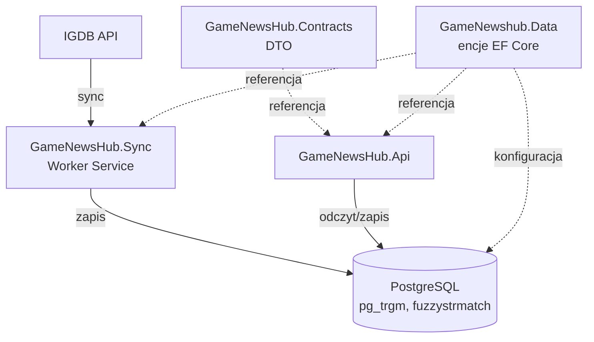

## Cel aplikacji
Agregacja i personalizacja informacji o wydarzeniach z branży gier (pokazy, prezentacje, showcase'y). System automatycznie pobierane dane o wydarzeniach i grach z zewnętrznego API (IGDB), oraz zwraca spersonalizowane rekomendacje na podstawie obserwowanych gier, gatunków, platform i wydarzeń.

Główny problem: wydarzenia branżowe dostają przypisane gry w IGDB dopiero po zakończeniu (2-3 dni), więc nadchodzące, jeszcze niezakończone wydarzenia nie mają danych do rekomendacji. System rozwiązuje to przez wykrywanie cykliczności wydarzeń i dziedziczenie przewidywanego profilu z poprzednich edycji.
## Diagram wysokopoziomowy

## Główne moduły/obszary funkcjonalne
- **Auth** - rejestracja, logowanie, JWT access + refresh httpOnly ciastko, role User/Admin
- **Sync z IGDB** - cykliczne pobieranie eventów, uzupełnienie gier, gatunków, platform - dociąganie brakujących danych
- **Cykliczność eventów** - wykrywanie powtarzalnych edycji tego samego wydarzenia (EventSeries), na podstawie nazw
- **Search** - wyszukiwanie gier i eventów
- **Panel admina** - korekta cykliczności eventów, zarządzanie platformami
- **Profil użytkownika** - follow/unfollow, ustawienia (np. widoczność niepewnych rekomendacji)

## Przepływ danych (ogólny)

## Stack

## Powiązane
